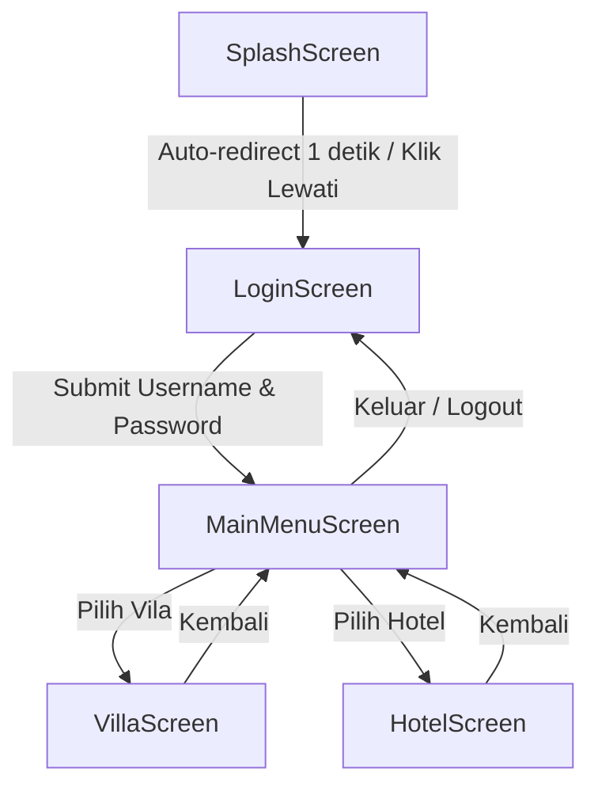

# 🏨 Pesan Hotel App (UTS Pemrograman Mobile)

Aplikasi mobile pemesanan penginapan (Hotel & Vila) sederhana berbasis **React Native** dan **Expo**. Dirancang dengan arsitektur navigasi *Native Stack*, alur pengguna yang intuitif, serta struktur kode yang ringkas dan mudah dipresentasikan.

---

## 📌 Daftar Isi
- [Tentang Aplikasi](#-tentang-aplikasi)
- [Fitur Utama](#-fitur-utama)
- [Teknologi yang Digunakan](#-teknologi-yang-digunakan)
- [Struktur Folder](#-struktur-folder)
- [Alur Navigasi Aplikasi](#-alur-navigasi-aplikasi)
- [Kredensial Login Demo](#-kredensial-login-demo)
- [Panduan Instalasi & Menjalankan](#-panduan-instalasi--menjalankan)
- [Screenshots & Penjelasan Layar](#-screenshots--penjelasan-layar)
- [Identitas Mahasiswa](#-identitas-mahasiswa)

---

## 📖 Tentang Aplikasi

**Pesan Hotel App** adalah proyek aplikasi mobile yang dibuat untuk memenuhi tugas Ujian Tengah Semester (UTS). Aplikasi ini menyediakan antarmuka bagi pengguna untuk menjelajahi katalog penginapan, memilih tipe kamar hotel, serta melihat pilihan vila liburan keluarga dengan informasi tarif dan fasilitas yang transparan.

---

## ✨ Fitur Utama

1. **Splash Screen Interaktif**:
   - Tampilan pembuka aplikasi dengan logo dan indikator *loading*.
   - Otomatis berpindah (*auto-redirect*) ke halaman Login setelah 1 detik.
   - Tombol manual `Lewati ke Login →` untuk pengguna yang ingin langsung masuk.

2. **Halaman Autentikasi (Login)**:
   - Form input *Username* dan *Password* (`secureTextEntry`).
   - Validasi input (peringatan alert jika kolom kosong).
   - Pengiriman parameter nama pengguna (*state navigation props*) ke Menu Utama.

3. **Menu Utama (Dashboard)**:
   - Ucapan selamat datang dinamis (*personalized greeting*) sesuai user yang login.
   - Navigasi kategori cepat: **Pilihan Vila** dan **Pilihan Kamar Hotel**.
   - Tombol **Logout** untuk kembali ke halaman login.

4. **Katalog Kamar Hotel (`HotelScreen`)**:
   - Daftar kamar hotel:
     - **Kamar Standar** (1 Queen Bed - Rp 350.000 / malam)
     - **Kamar VIP** (1 King Size Bed - Rp 750.000 / malam)
     - **Kamar President Suite** (Master Suite + Ruang Tamu - Rp 1.800.000 / malam)
   - Informasi fasilitas kamar lengkap.
   - Tombol pemesanan langsung dengan konfirmasi *Alert*.

5. **Katalog Pilihan Vila (`VillaScreen`)**:
   - Daftar tipe vila:
     - **Villa Minimalis Modern** (Tipe Studio 1 Kamar - Rp 750.000 / malam)
     - **Villa Family Garden** (Tipe 2 Kamar Tidur - Rp 1.500.000 / malam)
     - **Villa Luxury Panoramic** (Tipe 4 Kamar VIP - Rp 2.800.000 / malam)
   - Detail fasilitas eksklusif (Private Pool, Jacuzzi, View Alam, BBQ).
   - Tombol pemesanan vila dengan konfirmasi *Alert*.

---

## 🛠 Teknologi yang Digunakan

| Komponen | Teknologi / Library | Versi |
| :--- | :--- | :--- |
| **Framework** | React Native | `0.88.0` |
| **Platform Runtime** | Expo SDK | `~58.0.14` |
| **Navigasi** | React Navigation (Native Stack) | `^7.5.1` / `^7.21.0` |
| **Library Pendukung** | `react-native-screens`, `react-native-safe-area-context` | Versi kompatibel Expo 58 |
| **Bahasa Pemrograman**| JavaScript (ES6+ / React 19) | `19.3.0` |

---

## 📂 Struktur Folder

```plaintext
uts/
├── assets/                  # Aset ikon dan splash default Expo
├── src/
│   └── screens/
│       ├── SplashScreen.js   # Layar pembuka aplikasi (Timer & Loading)
│       ├── LoginScreen.js    # Layar login & validasi form
│       ├── MainMenuScreen.js # Layar beranda / menu utama navigasi
│       ├── HotelScreen.js    # Layar daftar kamar hotel & fasilitas
│       └── VillaScreen.js    # Layar daftar jenis & tipe vila
├── App.js                   # Konfigurasi Stack Navigator & Entry Point
├── app.json                 # Konfigurasi aplikasi Expo
├── package.json             # Manifest dependensi & skrip npm
└── README.md                # Dokumentasi proyek
```

---

## 🗺 Alur Navigasi Aplikasi



---

## 🔑 Kredensial Login Demo

Aplikasi telah dilengkapi nilai *default* pada *input field* untuk mempermudah demonstrasi dan pengujian:

- **Username:** `admin`
- **Password:** `12345`

*(Anda juga dapat mengganti nilai ini dengan nama atau input apa saja saat demonstrasi)*.

---

## 🚀 Panduan Instalasi & Menjalankan

### 1. Prasyarat Sistem
- Pastikan telah menginstal **Node.js** (versi 18 LTS atau lebih baru).
- Instal aplikasi **Expo Go** pada perangkat fisik Android (via Google Play Store) atau iOS (via App Store).

### 2. Kloning / Buka Proyek
Masuk ke direktori proyek melalui terminal:
```bash
cd uts
```

### 3. Instalasi Dependensi
Jalankan perintah berikut untuk mengunduh semua library yang diperlukan:
```bash
npm install
```

### 4. Menjalankan Server Expo
Mulai *bundler* Expo:
```bash
npx expo start
```
atau
```bash
npm start
```

### 5. Membuka Aplikasi
- **Pada HP Android:** Buka aplikasi **Expo Go**, lalu scan QR code yang muncul di terminal atau browser.
- **Pada Web Browser:** Tekan tombol `w` di terminal untuk menjalankan versi web.
- **Pada Emulator Android:** Tekan tombol `a` di terminal jika Android Studio emulator sudah terpasang.

---

## 📱 Penjelasan Layar (Screens)

1. **[SplashScreen.js](file:///f:/project/uts/src/screens/SplashScreen.js)**:
   - Memakai hook `useEffect` untuk menjalankan timer `setTimeout` 1000ms.
   - Memakai `navigation.replace('Login')` agar pengguna tidak bisa kembali ke layar splash saat menekan tombol *back*.

2. **[LoginScreen.js](file:///f:/project/uts/src/screens/LoginScreen.js)**:
   - Memakai hook `useState` untuk menyimpan nilai input `username` dan `password`.
   - Melakukan validasi kolom dan mengirim nama user lewat rute `navigation.replace('MainMenu', { user: username })`.

3. **[MainMenuScreen.js](file:///f:/project/uts/src/screens/MainMenuScreen.js)**:
   - Menerima parameter nama pengguna melalui `route.params?.user`.
   - Menyediakan 2 tombol kartu navigasi (`Villa` dan `Hotel`) serta tombol logout.

4. **[VillaScreen.js](file:///f:/project/uts/src/screens/VillaScreen.js)**:
   - Merender array objek `DAFTAR_VILLA` menggunakan method `.map()`.
   - Menampilkan detail informasi dan tombol aksi dengan pop-up `Alert.alert`.

5. **[HotelScreen.js](file:///f:/project/uts/src/screens/HotelScreen.js)**:
   - Merender array objek `DAFTAR_KAMAR` menggunakan method `.map()`.
   - Menampilkan spesifikasi kamar dan tombol aksi interaktif.

---

## 👤 Identitas Mahasiswa

- **Nama:** Naufal Elghazy
- **Mata Kuliah:** Pemrograman Mobile
- **Dosen Pengampu:** Pak Dedih
- **Tugas:** Ujian Tengah Semester (UTS)
